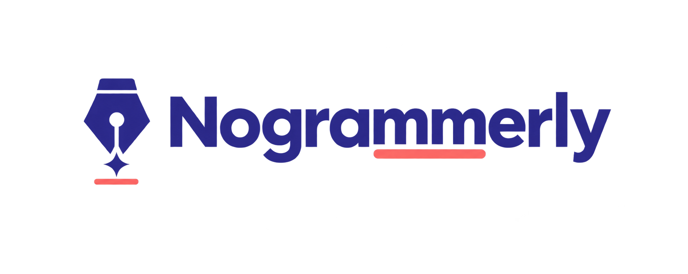
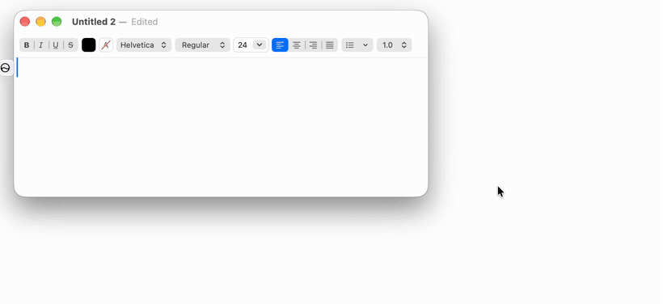

<p align="center"></p>

<p align="center"><b>The free, open-source, 100% on-device Grammarly alternative for macOS.</b><br>
Spelling, grammar, clarity and tone checks plus one-click rewrites, in Slack, Notes, Mail, Zoom, Sublime Text and almost every other app.<br>
Powered by Apple Intelligence. Your writing never leaves your Mac.</p>

<p align="center">
  <a href="https://github.com/gaurabh-pei/nogrammerly/releases/latest"></a>
  <a href="https://github.com/gaurabh-pei/nogrammerly/actions/workflows/swift.yml"></a>
  
  <a href="windows/README.md"></a>
  
  <a href="LICENSE"></a>
</p>

<p align="center"><a href="https://github.com/gaurabh-pei/nogrammerly/releases/latest"><b>⬇ Download for Mac</b></a> · <a href="windows/README.md"><b>Windows (beta)</b></a> · <a href="#how-it-works">How it works</a> · <a href="CONTRIBUTING.md">Contribute</a></p>

<p align="center"></p>

---

## Why Nogrammerly?

Cloud writing assistants read everything you type, including private Slack DMs, work email and medical notes, and send it to their servers. Nogrammerly does the same job **entirely on your Mac**, using Apple's on-device language model.

| | Nogrammerly | Cloud writing assistants |
|---|---|---|
| Where your text goes | **Stays on your Mac** | Sent to their servers |
| Price | **Free** | Free tier, then a subscription |
| Account needed | **No** | Yes |
| Works offline | **Yes** | No |
| Source code | **Open (MIT)** | Closed |
| App size | **~2 MB** native Swift | Hundreds of MB |

## Features

- **Works everywhere.** It underlines problems in the text field you're typing in, in almost any app.
  - 🔴 correctness · 🔵 clarity · 🟣 delivery · 🟠 style
- **Right-click an underline** to see the suggestion and choose **Replace**, **Copy suggestion**, **Rewrite sentence**, **Ignore** or **Add to dictionary**.
- **A floating field button** sits in the bottom-right corner of the active field: a green ✦ when there are no issues, red with a count when there are. Click it to see all the suggestions, or to **rewrite the selection** or **the whole text**. Rewrites come in four tones: Professional, Friendly, Confident and Concise.
- **A menu-bar ✦ icon** shows the issue count for the current field, with the same actions.
- **A built-in editor** with a writing score, a tone picker and a ✦ Rewrite button.
- **Private by design.** Checks use macOS's spell checker, built-in style rules and Apple's on-device Foundation Models (Apple Intelligence). Nothing is sent over the network.

## Install

1. Download **Nogrammerly-Installer.dmg** from the [latest release](https://github.com/gaurabh-pei/nogrammerly/releases/latest).
2. Open it and drag **Nogrammerly** into **Applications**.
3. Open Nogrammerly from Applications. The app isn't notarized by Apple yet, so the first time, macOS will block it. Go to **System Settings › Privacy & Security**, scroll down and click **Open Anyway**. You only need to do this once.
4. Follow the **Setup** window. It walks you through allowing Accessibility access and shows a live status for each step.

| Requirement | |
|---|---|
| macOS | 14 Sonoma or later, on Apple silicon |
| AI checks & rewrites | macOS 26+ with Apple Intelligence turned on. Without it you still get spelling, grammar and style checks. |
| Permission | Accessibility (System Settings › Privacy & Security › Accessibility) |

### Windows (beta)

A Windows version lives in [`windows/`](windows/README.md). It has the same underlines, right-click fixes, field button and rewrites. On Copilot+ PCs it can use Phi Silica, the on-device model built into Windows. See the [Windows install guide](windows/README.md).

## Build

You need the Xcode Command Line Tools (Swift 5.10+). Full Xcode isn't required.

```bash
# One-time: create a self-signed code-signing identity in your login keychain.
# Without it, builds are signed ad hoc and macOS forgets the Accessibility
# permission after every rebuild.
./script/create_signing_identity.sh

./script/build_and_run.sh            # build dist/Nogrammerly.app and launch it
./script/build_and_run.sh --bundle   # build only
./script/build_and_run.sh --logs     # launch and stream logs
./script/create_dmg.sh               # build dist/Nogrammerly-Installer.dmg
swift test                           # run the WritingEngine tests (also run by GitHub Actions)
```

The icon is generated from `Assets/Nogrammerly-icon.png` (a 1024×1024 image with square edges that fills the whole canvas). `script/create_icon.sh` masks it to the macOS rounded-square shape and builds the `.icns`.

## How it works

Nogrammerly works the way system-wide checkers like Grammarly Desktop do:

1. **Read.** It uses the macOS Accessibility API to find the focused text element and read its value and selection. For Electron apps such as Slack, it sets `AXManualAccessibility` so their text fields become readable. Password fields are always skipped.
2. **Analyse.** `NSSpellChecker` handles spelling and grammar, phrase rules catch wordiness and hedging, and Apple's on-device language model does contextual proofreading. AI results are cached per paragraph and debounced while you type.
3. **Draw.** It asks the app where each issue is on screen (`AXBoundsForRange`) and draws underlines in a transparent overlay panel that lets clicks pass through.
4. **Interact.** A session event tap picks up right-clicks that land on an underline, and only those; every other click passes through to the app.
5. **Replace.** It selects the issue's range and writes the replacement text through the Accessibility API, so undo (⌘Z) works. If an app ignores that, it falls back to pasting and then restores your clipboard.

| File | Responsibility |
|---|---|
| `Sources/Nogrammerly/SystemWritingAssistant.swift` | Cross-app monitoring, overlay underlines, right-click menu, field button, text replacement |
| `Sources/Nogrammerly/WritingEngine.swift` | Spelling, grammar and style rules; merging suggestions |
| `Sources/Nogrammerly/AIWriter.swift` | On-device Foundation Models proofreading and rewrites |
| `Sources/Nogrammerly/SetupWindowController.swift` | First-run setup guide with live status |
| `Sources/Nogrammerly/AppDelegate.swift` | App lifecycle, menus, built-in editor window |
| `script/` | Build, signing, icon, and DMG scripts |

## Troubleshooting

- **Accessibility is switched on but Setup still shows it amber.** macOS ties the approval to the exact signed build. Click **Reset & Ask Again** in the Setup window and switch Nogrammerly on again. With the stable signing identity this is only needed once.
- **No underlines in one app.** Some apps don't report where their text is on screen. The field button and the ✦ menu-bar icon still list and apply every suggestion.
- **Grammarly or another checker is installed.** Their underlines may overlap with Nogrammerly's. Turn one of them off.
- **AI suggestions are missing.** Make sure Apple Intelligence is turned on and has finished downloading.

## Uninstall

Quit Nogrammerly from the ✦ menu. Drag it from Applications to the Bin, then remove it from System Settings › Privacy & Security › Accessibility.

---

<p align="center">Nogrammerly is an independent open-source project. It is not affiliated with, endorsed by or connected to Grammarly, Inc.<br>
If it saves you a subscription, please ⭐ <b>star the repo</b>. It helps other people find it.</p>
